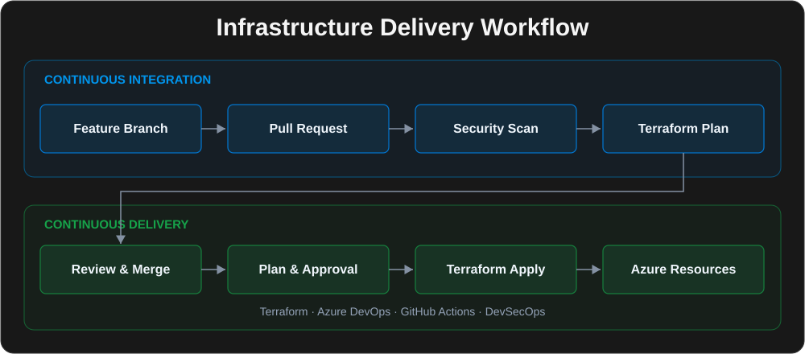

<!-- ========================================================= -->
<!--                    PROFILE HEADER                         -->
<!-- ========================================================= -->

<h1 align="center">👋 Hi, I'm Prateek Gupta</h1>

<h3 align="center">
  Cloud | DevOps | DevSecOps Engineer
</h3>

  Azure-Focused · Multi-Cloud Knowledge

<!-- ENGINEERING LIFECYCLE -->

<h3 align="center">
  From Architecture to Operations
</h3>

  
  &nbsp;➜&nbsp;
  
  &nbsp;➜&nbsp;
  
  &nbsp;➜&nbsp;
  
  &nbsp;➜&nbsp;
  

  <i>Scalable by Design · Secure by Default · Automated by Code</i>

  

---

## 👨‍💻 About Me

I am a **Cloud & DevOps Engineer** with hands-on experience in Azure infrastructure, Terraform, CI/CD automation, DevSecOps, and application deployment.

My work focuses on transforming architectural requirements into secure, scalable, governed, and automated cloud environments.

I am particularly interested in **Enterprise Cloud Architecture, Infrastructure Automation, Platform Engineering, Security, and Reliability.**

---

## 🛠️ Skills & Technologies

### ☁️ Cloud Platforms

  

**Primary Cloud:** Microsoft Azure

**Multi-Cloud Fundamentals:** AWS & Google Cloud Platform

- **Compute:** Virtual Machines, App Service, Azure Bastion
- **Networking:** VNet, Subnets, NSG, Load Balancer, Application Gateway, NAT Gateway
- **Storage & Database:** Blob Storage, PostgreSQL Flexible Server
- **Identity & Security:** Microsoft Entra ID, RBAC, Key Vault, Managed Identities
- **Integration & Monitoring:** Event Hubs, Azure Monitor, Log Analytics

### ⚙️ DevOps & CI/CD

  

**Azure DevOps · GitHub Actions · Git · GitHub**

- Infrastructure & Application CI/CD
- YAML & Classic Build/Release Pipelines
- Branching, Pull Requests & Branch Policies
- Self-Hosted Agents, Runners & Service Connections
- OIDC, Build Artifacts & Deployment Approvals
- Multi-Environment Deployment Automation

### 🏗️ Infrastructure as Code

  

**Terraform**

- Reusable Modules & Infrastructure Automation
- Remote Backend, State Management & Locking
- Variables, Outputs, Data Sources & Dependencies
- Dynamic Blocks & Terraform Expressions
- Multi-Environment Infrastructure Provisioning

### 🛡️ DevSecOps

Integrating security and quality checks into infrastructure and application delivery.

| Area | Tools |
| :--- | :--- |
| IaC Security | `Checkov` `tfsec` `Terrascan` |
| Secret Detection | `Gitleaks` `TruffleHog` |
| Vulnerability Scanning | `Trivy` |
| Code Quality | `TFLint` |
| Cost Estimation | `Infracost` |

**Practices:** Shift-Left Security, Secrets Management, Least Privilege, Secure Authentication & Policy as Code.

### 🐳 Containers & Orchestration

  

**Docker:** Images, Containers, Dockerfile, Volumes, Networking & Docker Compose.

**Kubernetes Fundamentals:** Pods, Deployments, Services, ConfigMaps, Secrets, Ingress & Scaling.

**Exploring:** GitOps & Argo CD.

### 💻 Scripting & Operating Systems

  

**Python · Bash · PowerShell · Linux · Azure CLI**

Infrastructure Automation, Deployment Scripts & CLI-Based Operations.

---

## 🏢 Cloud Architecture & Enterprise Design

### ☁️ Azure Landing Zone

Enterprise cloud architecture based on the Microsoft Cloud Adoption Framework (CAF).

- Platform & Application Landing Zones
- Management Groups & Subscriptions
- Subscription Vending & Workload Onboarding
- Hub-and-Spoke Architecture
- Identity, Connectivity & Governance
- Azure Policy, Resource Locks & Tagging

### 🌐 Networking & Cloud Security

- VNet Peering, Route Tables, DNS & Private DNS Zones
- Service Endpoints & Private Endpoints
- Application Gateway, WAF & Load Balancers
- Azure Bastion, NAT Gateway & Firewall Concepts
- RBAC, Managed Identities & Secure Access

### 📐 HLD & LLD Architecture

| High-Level Design (HLD) | Low-Level Design (LLD) |
| :--- | :--- |
| System & Cloud Architecture | Resource Configuration |
| Network & Security Architecture | Subnets, NSGs & Routing |
| Component Interaction & Data Flow | Terraform Modules |
| Scalability & High Availability | CI/CD Implementation |
| Disaster Recovery Strategy | Naming & Tagging Standards |

### 📊 Monitoring, Reliability & FinOps

**Monitoring:** Azure Monitor, Log Analytics, Metrics, Logs & Alerts.

**Observability Fundamentals:** Prometheus & Grafana.

**Reliability:** High Availability, Backup, Disaster Recovery & Scalability.

**Cost Optimization:** Right-Sizing, Autoscaling, Reserved Instances, Budgets & Infracost.

---

## 🚀 Featured Projects & Hands-On Implementations

<table>
  <tr>
    <td width="50%" valign="top">
      <h3>☁️ Azure Landing Zone</h3>
      

        Enterprise cloud architecture practice focused on governance, identity, workload isolation, hub-and-spoke networking and private connectivity.
      

      

        <code>Azure</code>
        <code>Terraform</code>
        <code>Networking</code>
        <code>Governance</code>
      

    </td>
    <td width="50%" valign="top">
      <h3>🏗️ Terraform Infrastructure Modules</h3>
      

        Reusable modules for provisioning Resource Groups, VNets, Subnets, NSGs, NICs, Virtual Machines and Azure Bastion.
      

      

        <code>Terraform</code>
        <code>Azure</code>
        <code>IaC</code>
        <code>Remote State</code>
      

    </td>
  </tr>
  <tr>
    <td width="50%" valign="top">
      <h3>⚙️ Terraform DevSecOps Pipeline</h3>
      

        Automated infrastructure validation, security scanning, cost estimation, Terraform planning and approval-based provisioning.
      

      

        <code>Azure DevOps</code>
        <code>GitHub Actions</code>
        <code>Terraform</code>
        <code>DevSecOps</code>
      

    </td>
    <td width="50%" valign="top">
      <h3>🚀 NextOps Application Deployment</h3>
      

        Multi-component application deployment involving ingestion services, PostgreSQL, backend APIs and frontend dashboard using Linux VMs and Azure App Service.
      

      

        <code>Azure</code>
        <code>Linux</code>
        <code>PostgreSQL</code>
        <code>FastAPI</code>
        <code>React</code>
      

    </td>
  </tr>
  <tr>
    <td width="50%" valign="top">
      <h3>🔐 Secure Cloud File Sharing</h3>
      

        Controlled file access using Azure Blob Storage, private containers, SAS tokens and Terraform-based provisioning.
      

      

        <code>Azure Storage</code>
        <code>Terraform</code>
        <code>SAS</code>
        <code>Cloud Security</code>
      

    </td>
    <td width="50%" valign="top">
      <h3>🌐 Three-Tier Cloud Architecture</h3>
      

        Architecture practice involving application gateways, frontend and backend tiers, internal load balancing, private database connectivity and secure administrative access.
      

      

        <code>Azure</code>
        <code>WAF</code>
        <code>Load Balancer</code>
        <code>Private Endpoint</code>
      

    </td>
  </tr>
</table>

---

## ⚙️ Infrastructure Delivery Workflow

  

---

<h2 align="center">🐍 Contribution Snake</h2>

  

---

## 🌐 Connect With Me

  

  

  

---

<h4 align="center">
  Thanks for visiting my profile!
</h4>
